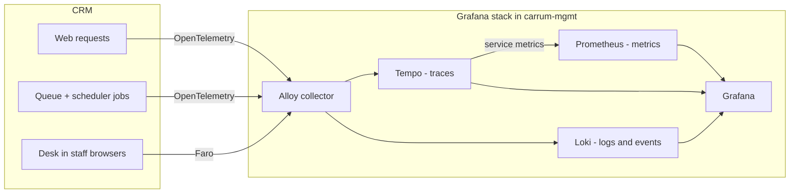

# Observability — Product Guide

**Feature:** Platform Monitoring  
**Status:** Live  
**Primary tool:** Grafana (`https://grafana.carrum.co.in`, company sign-in)

---

## What is observability in Carrum CRM?

Observability gives engineering and operations teams a shared view of how the CRM behaves in production: which requests are slow, which jobs fail, which users hit errors, and how agents use key screens.

The platform sends four kinds of telemetry to the Grafana stack (self-hosted in GCP project `carrum-mgmt`):

| Signal | What it answers | Stored in |
|---|---|---|
| **Traces** | Which API calls, pages or background jobs are slow or failing, and where the time goes (SQL, Redis, outgoing calls)? | Tempo |
| **Logs** | What happened around an error — full stack trace and request context? | Loki |
| **Business events** | How are users engaging with CRM features (e.g. lead views)? | Loki |
| **Browser (Desk)** | How fast do Desk pages load for staff, and which JavaScript errors do they hit? | Loki / Tempo |

All of this is automatic for HTTP traffic, background jobs, scheduled tasks and the Desk. Product teams do not need to instrument individual screens unless adding a new business event.

---

## Who is this for?

| Audience | Typical use |
|---|---|
| **Engineering** | Debug production errors, trace slow requests, jump from a log line to its trace |
| **Platform / DevOps** | Monitor job queue health, scheduler runs, release regressions; alerts go to Teams |
| **Product / Analytics** | Measure feature usage via business events (e.g. lead list vs detail views) |
| **Support / Ops** | Look up a failing request by user, site, or API method |

---

## What you can see in Grafana

### Web requests

Every inbound HTTP request is a trace in service **`erpnext`** with Frappe context attached:

- Site (`frappe.site`) and logged-in user (`enduser.id`)
- HTTP method, route, status code
- Frappe API command (`frappe.cmd`) when applicable — e.g. `/api/method/crm.api.lead.get_lead`
- Every SQL query (values hidden), Redis call and outgoing HTTP call made by the request

Routes are grouped so dashboards show one line per endpoint, not one per document: `/api/resource/Lead/{name}`, `/app/lead/{name}`.

### Background work

Queue jobs and scheduled jobs are traces in service **`erpnext-worker`**:

- Queue jobs are named `job <python.method>`
- Scheduled jobs are named `scheduled <job_type>` (e.g. `scheduled crm.tasks.sync_facebook_leads`)
- Each job shows its queue, how long it waited in the queue, and its SQL/Redis calls; failed jobs are marked as errors with the exception

### Application logs

When errors occur, the full exception message and stack trace are exported (not just the generic Frappe one-liner). Every log line carries the **`trace_id`** of the request or job it came from, so you can jump between a slow trace and its error log in one click.

### Business events

| Event | Description |
|---|---|
| `CrmLeadViewed` | A user opened one or more leads in the list or detail view |

### Desk browser monitoring

Page load times, Core Web Vitals, JavaScript errors and AJAX timings from staff browsers, sent with Grafana Faro. Browser requests are linked to the backend trace they triggered. There is no session replay or console capture.

---

## How it works (high level)



1. The web server runs through an OpenTelemetry entry point, so every request is traced.
2. After each response, Frappe context (site, user, command) is attached to the trace.
3. Before and after each background job, Frappe's job hooks start and finish the job's trace.
4. Python logs and Frappe errors are normalized and exported with the trace they belong to.
5. Lead views are recorded via a lightweight API that emits business events — failures never block the UI.

---

## Privacy and data handling

- SQL in traces is the statement template (`WHERE name=%(param1)s`); **values are never recorded**.
- Request bodies are **not** captured by default. If temporarily enabled (`OTEL_CAPTURE_REQUEST_BODY`), keys containing `password`, `token`, `secret`, `key` are redacted and payloads are truncated.
- Browser monitoring records no screen content (no session replay) and no console logs.
- Guest users are excluded from lead-view events.
- Grafana is reachable only through company sign-in (IAP).

If a new feature sends sensitive fields, confirm they are not included in business event attributes before shipping.

---

## Common workflows

### Investigate a user-reported error

1. Open Grafana → **Explore** → data source **Tempo**.
2. Search `{resource.service.name="erpnext" && span.enduser.id="user@carrum.co.in" && status=error}`.
3. Open the trace → **Logs for this span** to see the linked stack trace.

### Check scheduler or queue health

1. Open **Observability → Service overview**, service `erpnext-worker`.
2. Sort the "Slowest endpoints and jobs" and "Most errors" tables to find stuck or failing jobs.

### Measure lead engagement

In **Explore** with data source **Loki**:

```logql
sum by (view_type, route_name) (count_over_time({service_name="erpnext"} | event_name="CrmLeadViewed" [1d]))
```

---

## What's not covered

- **Infrastructure metrics** (CPU, memory, disk of the VMs and databases) — these stay in GCP Cloud Monitoring, with alerts to Teams.
- **Chatwoot, telephony, or third-party SaaS** — only the CRM/Frappe processes are instrumented.

---

## Related documentation

- [Observability — technical documentation](../../technical/observability/readme.md)
